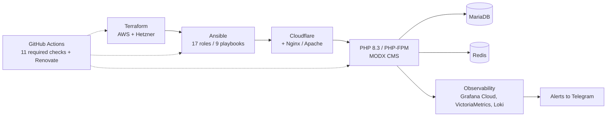

# Vitali Kuts · Infrastructure / DevOps Engineer

**I build production infrastructure end-to-end, and I back it with CI instead of slides.**

Co-founder & CTO of **DreamSeed**. I own the layer below the application: cloud, servers, deploys,
secrets, backups, monitoring and disaster recovery.

## 🌱 Flagship — [DreamSeed Infrastructure](https://github.com/W1ckedS1ck/DreamSeed)

Production IaC behind [dreamseed.online](https://dreamseed.online), a live product with real users,
accounts and payments. Two environments (Hetzner prod, AWS dev) provisioned from the same code.

| What | Detail |
| --- | --- |
| Provisioning | one command, empty cloud account → live server in ~8–10 min, safe to re-run |
| Configuration | 17 idempotent Ansible roles across 9 playbooks, Ansible Vault for secrets |
| Quality gates | 11 required checks per PR: ShellCheck, ansible-lint, Terraform fmt/tflint/validate, Checkov, Trivy, Gitleaks, zizmor, actionlint, pre-commit |
| Backups | hourly encrypted snapshots, restored in CI from both local and cloud paths |
| Disaster recovery | scheduled drills on an ephemeral server: restore → 60+ service assertions, target RTO under 5 minutes |
| Monitoring | Grafana Cloud synthetic probes from 5 locations on 3 continents, Better Stack watchdogs, 28 Grafana alert rules → Telegram |
| Safety | prod deploys wait for an environment approval, destroy requires a typed confirmation, daily drift detection |
| Deliberate choice | no Docker in production: a traditional PHP CMS gains nothing from it here, Ansible already gives idempotent provisioning |

📖 [Architecture & runbooks](https://github.com/W1ckedS1ck/DreamSeed/wiki) ·
📐 [ADRs](https://github.com/W1ckedS1ck/DreamSeed/tree/main/docs/adr) ·
🗺️ [Code map](https://w1ckeds1ck.github.io/DreamSeed/) ·
🌐 [Live status](https://status.dreamseed.online)

## 🧰 Toolchain

`Terraform` · `Ansible` · `GitHub Actions` · `Bash / Python` · `AWS` · `Hetzner` · `Cloudflare` ·
`Grafana / VictoriaMetrics / Loki` · `MariaDB` · `Redis` · `Nginx / Apache` · `Linux hardening`

## 🗺️ Other repositories

- [Terraform](https://github.com/W1ckedS1ck/Terraform) — modules, providers and state, built as a lab
- [Ansible](https://github.com/W1ckedS1ck/Ansible) — roles, playbooks and inventories, built as a lab
- [DBandKafka](https://github.com/W1ckedS1ck/DBandKafka) — data-plane experiments

## 📫 Contact

Infrastructure questions: [issues](https://github.com/W1ckedS1ck/DreamSeed/issues) or
[discussions](https://github.com/W1ckedS1ck/DreamSeed/discussions) in DreamSeed.
