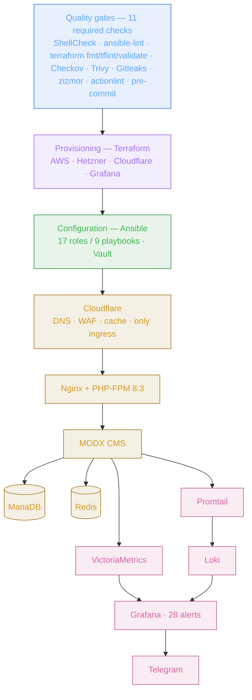

<h1>Vitali Kuts</h1>
<h3>Infrastructure / DevOps Engineer</h3>

I build production platforms end to end — and back every claim with CI instead of slides. 
Co-founder &amp; CTO of <a href="https://dreamseed.online"><b>DreamSeed</b></a> — a live product with real users, accounts and payments.

  

  

<a href="https://github.com/W1ckedS1ck/DreamSeed/wiki">Architecture &amp; runbooks</a> ·
<a href="https://github.com/W1ckedS1ck/DreamSeed/tree/main/docs/adr">ADRs</a> ·
<a href="https://w1ckeds1ck.github.io/DreamSeed/">Code map</a> ·
<a href="https://status.dreamseed.online">Live status</a>

---

## 🌱 Flagship — DreamSeed Infrastructure

One codebase, any cloud: **[prod on Hetzner](https://dreamseed.online)**, **dev on Hetzner or AWS** — provisioned, hardened and monitored from the same Terraform roots and the same Ansible roles.

<table>
<tr>
<td width="50%" valign="top">

**Provisioning & delivery**

- one command: empty cloud account → live, hardened server in ~8–10 min, safe to re-run
- Terraform roots for **AWS, Hetzner, Cloudflare, Grafana** — provider-split on purpose ([ADR-001](https://github.com/W1ckedS1ck/DreamSeed/blob/main/docs/adr/ADR-001-provider-split-roots.md))
- **17 idempotent Ansible roles / 9 playbooks**, secrets in Ansible Vault ([ADR-007](https://github.com/W1ckedS1ck/DreamSeed/blob/main/docs/adr/ADR-007-secrets-architecture.md))
- **11 required checks** on every PR, Renovate-only dependency PRs

</td>
<td width="50%" valign="top">

**Running it in production**

- Cloudflare-only ingress, Nginx + PHP-FPM 8.3, MODX, MariaDB, Redis ([ADR-005](https://github.com/W1ckedS1ck/DreamSeed/blob/main/docs/adr/ADR-005-cloudflare-only-ingress.md))
- hourly **AES-256** encrypted backups → Google Drive, 5/15/3 version rotation
- **weekly restore drills** on an ephemeral server, measured **RTO < 5 min**, **RPO ≤ 1 h** ([ADR-006](https://github.com/W1ckedS1ck/DreamSeed/blob/main/docs/adr/ADR-006-weekly-dr-rehearsal.md))
- 28 Grafana alerts → Telegram, Grafana Cloud probes from 3 continents, Better Stack watchdogs

</td>
</tr>
</table>

## 📊 By the numbers

Every number below links to the thing that proves it.

| What | Value | Where |
| --- | :---: | --- |
| Ansible roles / playbooks | **<!--n:roles-->17<!--/n:roles--> / <!--n:playbooks-->9<!--/n:playbooks-->** | [`ansible-roles/`](https://github.com/W1ckedS1ck/DreamSeed/tree/main/ansible-roles) · [`ansible/`](https://github.com/W1ckedS1ck/DreamSeed/tree/main/ansible) |
| GitHub Actions workflows | **<!--n:workflows-->12<!--/n:workflows-->** | [`.github/workflows/`](https://github.com/W1ckedS1ck/DreamSeed/tree/main/.github/workflows) |
| Required checks per PR | **11** | [`ci.yml`](https://github.com/W1ckedS1ck/DreamSeed/blob/main/.github/workflows/ci.yml) + `Protect Main` ruleset |
| Architecture decision records | **<!--n:adrs-->8<!--/n:adrs-->** | [`docs/adr/`](https://github.com/W1ckedS1ck/DreamSeed/tree/main/docs/adr) |
| Grafana alert rules | **28** | [`docs/architecture.md`](https://github.com/W1ckedS1ck/DreamSeed/blob/main/docs/architecture.md#alert-rules-grafana--28-rules) |
| fail2ban jails (edge bans via Cloudflare) | **6** | [`docs/runbook.md`](https://github.com/W1ckedS1ck/DreamSeed/blob/main/docs/runbook.md) |

## 🏛 How it fits together

## 🛡 Production signals

Pulled from the DreamSeed repository and its Actions on a schedule — not copy-pasted by hand.

<!-- AUTO:START -->
| Signal | Result | Last run |
| --- | --- | --- |
| 🧪 DR drill — restore an hourly backup on a fresh server | ✅ success | 23 Nov 2026 · [run](https://github.com/W1ckedS1ck/DreamSeed/actions/runs/45273285194) |
| 🚀 Production deploy | ✅ success | 12 Nov 2026 · [run](https://github.com/W1ckedS1ck/DreamSeed/actions/runs/43194317233) |
| ✅ CI on `main` | ✅ success | 27 Nov 2026 · [run](https://github.com/W1ckedS1ck/DreamSeed/actions/runs/45952206537) |
<!-- AUTO:END -->

RTO is measured by the drill itself, not estimated: `RESTORE_ALL.sh --auto-latest` → schema, data, files, then service checks.

## 📚 Docs worth reading

These are the parts of the repo I would actually hand to a new engineer.

<b>Architecture decision records</b>

- [ADR-001](https://github.com/W1ckedS1ck/DreamSeed/blob/main/docs/adr/ADR-001-provider-split-roots.md) — provider-split Terraform roots instead of a shared abstraction
- [ADR-002](https://github.com/W1ckedS1ck/DreamSeed/blob/main/docs/adr/ADR-002-tfc-state-backend.md) — Terraform Cloud as the only state backend
- [ADR-003](https://github.com/W1ckedS1ck/DreamSeed/blob/main/docs/adr/ADR-003-dev-equals-prod.md) — dev mirrors prod everywhere
- [ADR-004](https://github.com/W1ckedS1ck/DreamSeed/blob/main/docs/adr/ADR-004-redis-sessions.md) — MODX sessions on Redis via the PHP native handler
- [ADR-005](https://github.com/W1ckedS1ck/DreamSeed/blob/main/docs/adr/ADR-005-cloudflare-only-ingress.md) — Cloudflare-only ingress to origins
- [ADR-006](https://github.com/W1ckedS1ck/DreamSeed/blob/main/docs/adr/ADR-006-weekly-dr-rehearsal.md) — weekly automated DR rehearsal
- [ADR-007](https://github.com/W1ckedS1ck/DreamSeed/blob/main/docs/adr/ADR-007-secrets-architecture.md) — secrets architecture
- [ADR-008](https://github.com/W1ckedS1ck/DreamSeed/blob/main/docs/adr/ADR-008-prod-migration-aws-to-hetzner.md) — production migration from AWS to Hetzner Cloud

<b>Runbooks & operations</b>

- [Runbook](https://github.com/W1ckedS1ck/DreamSeed/blob/main/docs/runbook.md) — 29 Grafana alert playbooks, each with a copy-paste diagnostic command
- [Operations guide](https://github.com/W1ckedS1ck/DreamSeed/blob/main/docs/operations-guide.md) — deploy flow, alert thresholds, failure handling
- [Architecture](https://github.com/W1ckedS1ck/DreamSeed/blob/main/docs/architecture.md) — data flow, network and observability topology
- [ChatOps](https://github.com/W1ckedS1ck/DreamSeed/blob/main/docs/chatops.md) — `/deploy <target> -a -p` from Telegram, with the same gates as the UI
- [Prerequisites](https://github.com/W1ckedS1ck/DreamSeed/blob/main/docs/prerequisites.md) — fresh machine → first deploy

## 🧰 Toolchain

**Cloud & runtime** 

**Configuration & CI** 

**Data & observability** 

## 🗺️ Other repositories

| Repository | What it is |
| --- | --- |
| [**Terraform**](https://github.com/W1ckedS1ck/Terraform) | modules, providers and state layout, built as a lab |
| [**Ansible**](https://github.com/W1ckedS1ck/Ansible) | roles, playbooks and inventories, built as a lab |
| [**DBandKafka**](https://github.com/W1ckedS1ck/DBandKafka) | data-plane experiments |
| [**telethon-service-template**](https://github.com/W1ckedS1ck/telethon-service-template) | a userbot service built the production way: env-only config, dry-run by default, rate limits, systemd unit, CI |

## 🐍 Contribution graph

<picture>
  <source media="(prefers-color-scheme: dark)" srcset="https://raw.githubusercontent.com/W1ckedS1ck/W1ckedS1ck/output/snake-dark.svg" />
  <source media="(prefers-color-scheme: light)" srcset="https://raw.githubusercontent.com/W1ckedS1ck/W1ckedS1ck/output/snake.svg" />
  
</picture>

<a href="https://github.com/W1ckedS1ck?tab=overview">Full contribution graph →</a>

## 📫 Contact

Infrastructure questions, review requests or a repo you want a second pair of eyes on — **[open an issue](https://github.com/W1ckedS1ck/DreamSeed/issues)** in DreamSeed. Public by default, so the answer helps the next person too.

This README refreshes itself: the signals and counts above are pulled from the DreamSeed repository by GitHub Actions, and the snake is generated nightly.

<!-- Last updated: 2026-11-27 12:57:39 UTC -->
