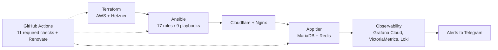

# Vitali Kuts · Infrastructure / DevOps Engineer

**I build production infrastructure end-to-end, and I back it with CI instead of slides.**

Co-founder & CTO of **DreamSeed**. I own the layer below the application: cloud, servers,
deploys, secrets, backups, monitoring and disaster recovery.

## 🌱 Flagship: [DreamSeed Infrastructure](https://github.com/W1ckedS1ck/DreamSeed)

Production IaC behind [dreamseed.online](https://dreamseed.online), a live product with real users,
accounts and payments.

- **Empty cloud account to live server in about 8–10 minutes**, one command, safe to re-run
- **Scheduled disaster-recovery drills**: backup, restore from the local and cloud paths, then
  service assertions. Target RTO is under 5 minutes
- **11 required CI checks on every PR**: ShellCheck, ansible-lint, Terraform fmt/tflint/validate,
  Checkov, Trivy, Gitleaks, zizmor, actionlint, pre-commit and others
- **Multi-region monitoring**: Grafana Cloud synthetic probes from 5 locations on 3 continents,
  Better Stack watchdogs, 28 Grafana alert rules, all routed to Telegram
- **Safety by design**: prod deploys wait for an environment approval, destroy needs a typed
  confirmation, daily drift detection raises alerts
- **Secrets discipline**: Ansible Vault as the source of truth, SHA-pinned actions, tokens kept out
  of process arguments, full-history secret scanning

📖 [Architecture & runbooks](https://github.com/W1ckedS1ck/DreamSeed/wiki) ·
🌐 [Live status](https://status.dreamseed.online) ·
📐 [Architecture decisions (ADRs)](https://github.com/W1ckedS1ck/DreamSeed/tree/main/docs/adr)

## 🧰 Stack

`Terraform` · `Ansible` · `GitHub Actions` · `Bash / Python` · `AWS` · `Hetzner` · `Cloudflare` ·
`Grafana / VictoriaMetrics / Loki` · `MariaDB` · `Redis` · `Nginx` · `Linux hardening`

## 🗺️ Other repositories

- [Terraform](https://github.com/W1ckedS1ck/Terraform) and
  [Ansible](https://github.com/W1ckedS1ck/Ansible): lab repos for practising modules, roles and providers
- [DBandKafka](https://github.com/W1ckedS1ck/DBandKafka): data-plane experiments

## 📫 Contact

Questions about the infrastructure are welcome as issues in [DreamSeed](https://github.com/W1ckedS1ck/DreamSeed/issues).
