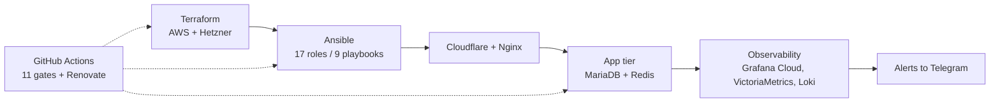

# Vitali Kuts · Infrastructure / DevOps Engineer

**I build production infrastructure end-to-end — and prove it with CI, not with slides.**

Co-founder & CTO of **DreamSeed**. I own everything below the application layer: cloud, servers,
deploys, secrets, backups, monitoring and disaster recovery.

## 🌱 Flagship — [DreamSeed Infrastructure](https://github.com/W1ckedS1ck/DreamSeed)

Production IaC behind [dreamseed.online](https://dreamseed.online) — a live product with real users,
accounts and payments, not a demo lab.

- **Zero → live server in ~8 minutes**, one command, idempotent all the way down
- **Disaster recovery rehearsed weekly by robots**: backup → simulated disaster → restore from local
  *and* cloud paths → 60+ service assertions, RTO < 5 min proven in CI
- **11 CI gates per push**: ShellCheck, ansible-lint, Terraform lint/validate/fmt, Checkov, Trivy,
  Gitleaks (full history), zizmor, actionlint, pre-commit
- **Multi-region observability**: Grafana Cloud synthetic probes on 3 continents, Better Stack
  watchdogs, 27 local alert rules → Telegram
- **Safety by design**: prod deploys behind environment approvals, destroy requires a typed
  confirmation, daily drift detection with alerts
- **Secrets discipline**: Ansible Vault as the source of truth, SHA-pinned actions, tokens never in
  argv, full-history leak scanning

📖 [Architecture & runbooks](https://github.com/W1ckedS1ck/DreamSeed/wiki) ·
🌐 [Live status](https://status.dreamseed.online) ·
💬 [Discussions](https://github.com/W1ckedS1ck/DreamSeed/discussions)

## 🧰 Stack

`Terraform` · `Ansible` · `GitHub Actions` · `Bash / Python` · `AWS` · `Hetzner` · `Cloudflare` ·
`Grafana / VictoriaMetrics / Loki` · `MariaDB` · `Redis` · `Nginx` · `Linux hardening`

## 🗺️ Elsewhere

- [Terraform](https://github.com/W1ckedS1ck/Terraform) and
  [Ansible](https://github.com/W1ckedS1ck/Ansible) — lab repos where I practise modules, roles and
  providers
- [DBandKafka](https://github.com/W1ckedS1ck/DBandKafka) — data-plane experiments

## 📚 Background

Hands-on path into infrastructure: Jenkins pipelines, Docker/Kubernetes, GitLab CI and monitoring
labs, then building and operating real production systems at DreamSeed since 2026. I prefer boring,
tested automation over clever one-offs.

## 📫 Contact

Infrastructure questions — open a [discussion](https://github.com/W1ckedS1ck/DreamSeed/discussions)
in DreamSeed; I answer there.
